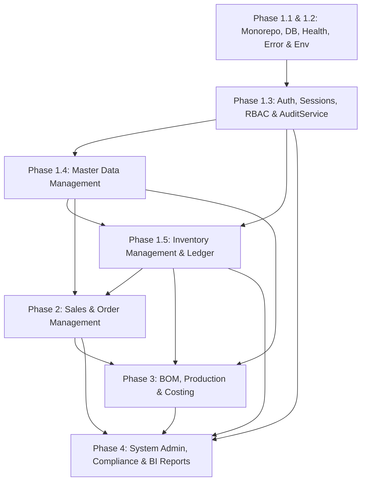

# FoodFactory ERP – Phase & Module Dependency Map

**Document Type:** Architectural Dependency & Integration Reference  
**Companion To:** [PROJECT_ROADMAP.md](file:///d:/somasri/projects/FoodFactoryERP/docs/architecture/PROJECT_ROADMAP.md)  
**Last Audited:** 2026-11-25

---

## 1. Layered Dependency Hierarchy

FoodFactory ERP is structured so that foundational infrastructure and master data sit at the base, transactional domains build upward, and compliance/reporting aggregate across all layers.

---

## 2. Cross-Module Integration Matrix

| Consumer Module | Upstream Dependency | Concrete Repository Integration |
| :--- | :--- | :--- |
| **All Backend Modules** | Phase 1.2 Core Infrastructure | `env` (`apps/api/src/config/env.ts`), `prisma` (`prisma.service.ts`), `AppError` / `errorHandler`, `sendSuccess` / `sendError` |
| **All Protected Routes & UI** | Phase 1.3 Auth & RBAC | `authenticate`, `requirePermissions(...)`, `ProtectedRoute`, `useAuth`, `AuditService.log()` |
| **Inventory (Phase 1.5)** | Phase 1.4 Master Data | References `InventoryItem`, `Warehouse`, `UnitOfMeasure`, `UnitConversion`, `Supplier`, `Customer` |
| **Sales & Orders (Phase 2)** | Phase 1.4 Master Data | Reads `Customer`, `CustomerAddress`, `ProductVariant`, `Warehouse`, `UnitOfMeasure`, `TaxRate`/`TaxConfiguration`, `Company` |
| **Sales & Orders (Phase 2)** | Phase 1.5 Inventory | Calls `InventoryReservationService.reserveStockInTx` on `/confirm`, releases on `/cancel`, and posts `InventoryIssue` on `/fulfill` |
| **BOM & Production (Phase 3)** *(Planned)* | Phase 1.4 Master Data | Uses `BOM`, `BOMVersion`, `BOMItem`, `BOMOverhead`, `RawMaterial`, `ProductVariant`, `UnitConversion` |
| **BOM & Production (Phase 3)** *(Planned)* | Phase 1.5 Inventory | Issues raw materials/packaging (`InventoryIssue` / `MaterialIssue`) and receives finished goods (`PRODUCTION_RECEIPT`) with MWAC blending |
| **Production Planning (Phase 3.2)** *(Planned)* | Phase 2 Sales & Orders | Reads confirmed `SalesOrder` demand to schedule `ProductionOrder` batches |
| **Costing & Reports (Phase 3.6–3.7)** *(Planned)* | Phase 3.4–3.5 & Phase 1.5 | Aggregates `MaterialIssue`, `MaterialReturn`, `ProductionOverhead`, `ProductionScrap`, and `InventoryTransactionLine` MWAC |
| **Compliance & BI (Phase 4.2–4.3)** *(Planned)* | Phases 1.5, 2, 3 | Aggregates sales, GST tax breakdowns, COGS, stock valuation, and expenses |
| **Audit & Governance (Phase 4.4)** *(Planned)* | Phase 1.3 `AuditService` | Queries immutable `audit_logs` written across all transactional modules |

---

## 3. Transactional & Concurrency Boundaries

1. **Database Transaction Boundary (`prisma.$transaction`)**:
   - Inventory postings (receipts, issues, transfers, adjustments) and Sales Order confirmations/fulfillments execute inside `prisma.$transaction`.
   - `InventoryBalance` rows are locked with `SELECT ... FOR UPDATE` (`FOR UPDATE OF b`) before mutating `quantityOnHand` or `quantityReserved`.
2. **Audit Boundary (`AuditService`)**:
   - `AuditService.log()` writes to `audit_logs` and catches/logs failures to stderr without crashing the host business transaction.
3. **Decimal Precision Boundary**:
   - All quantities (`Decimal(14,4)`), prices/taxes (`Decimal(14,2)`), valuation/MWAC (`Decimal(18,4)`), and UOM conversions (`Decimal(18,6)`) are persisted via Prisma `Decimal`—never JavaScript floating-point `number` math.
