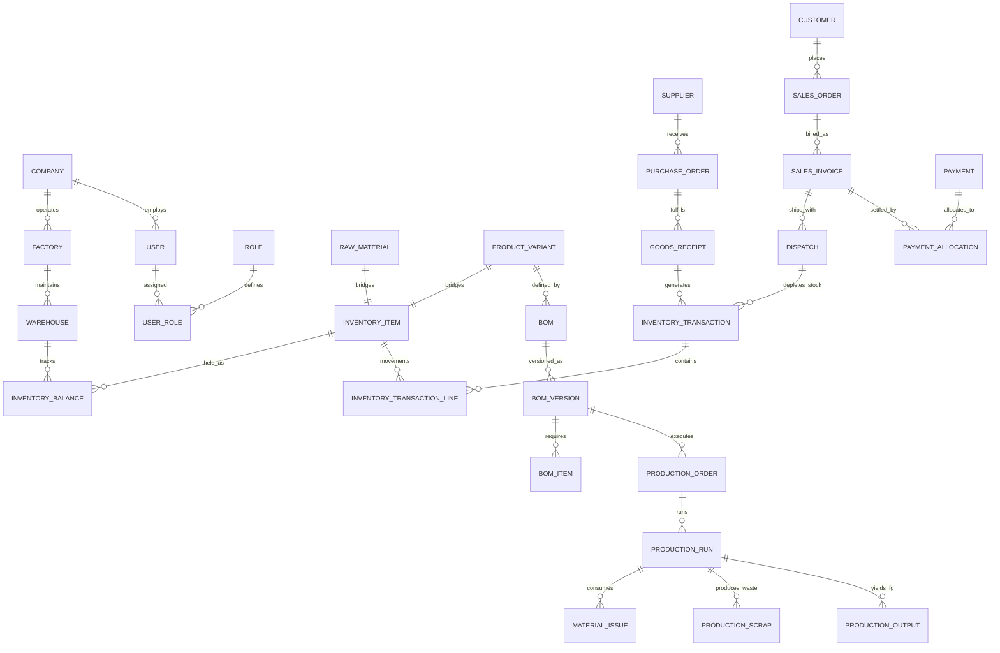
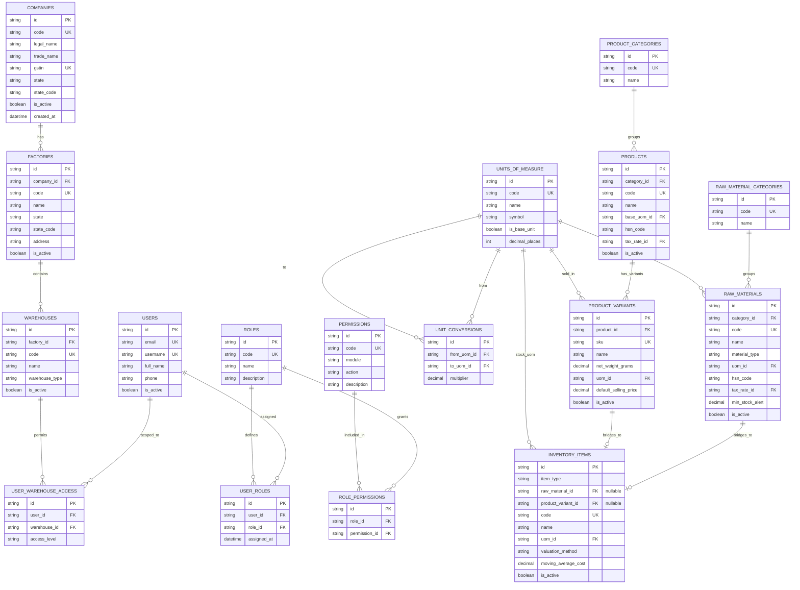
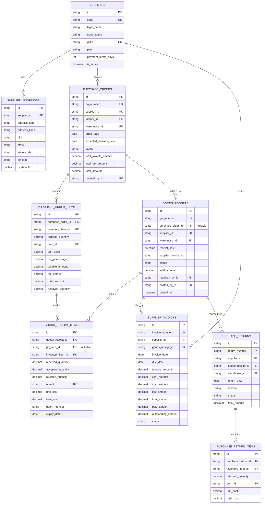
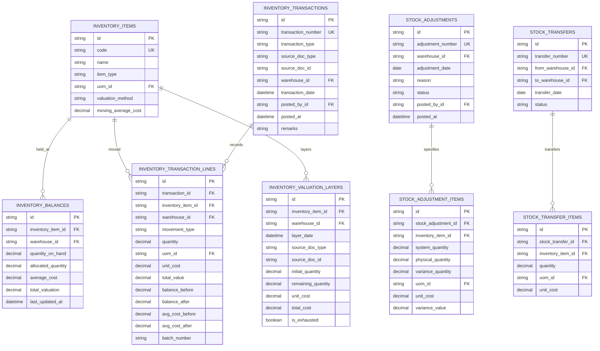
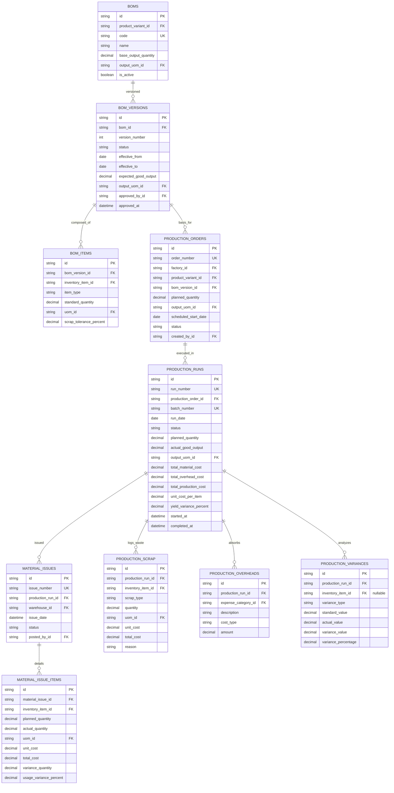
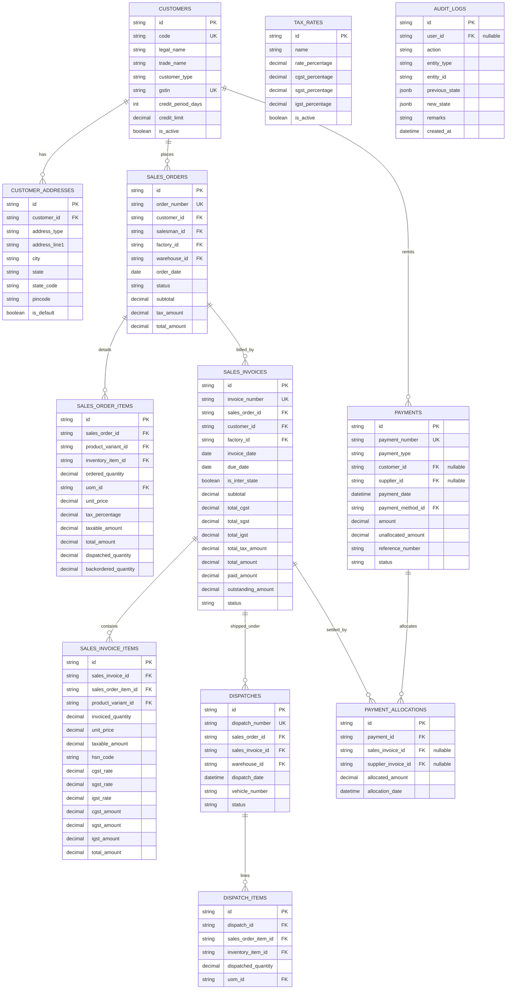

# FoodFactory ERP – Entity-Relationship (ER) Diagrams

This document contains the complete Entity-Relationship architecture for **FoodFactory ERP**. Due to the comprehensive scope of the manufacturing system, the model is presented as an integrated high-level domain map followed by modular ER diagrams with attributes, keys, and cardinalities.

---

## 1. High-Level Integrated Domain Map

---

## 2. Organization, Security & Master Data Domain

---

## 3. Purchasing & Supplier Management Domain

---

## 4. Immutable Inventory Ledger & Valuation Domain

---

## 5. Bill of Materials (BOM) & Production Costing Domain

---

## 6. Sales, GST, Invoicing & Payments Domain

