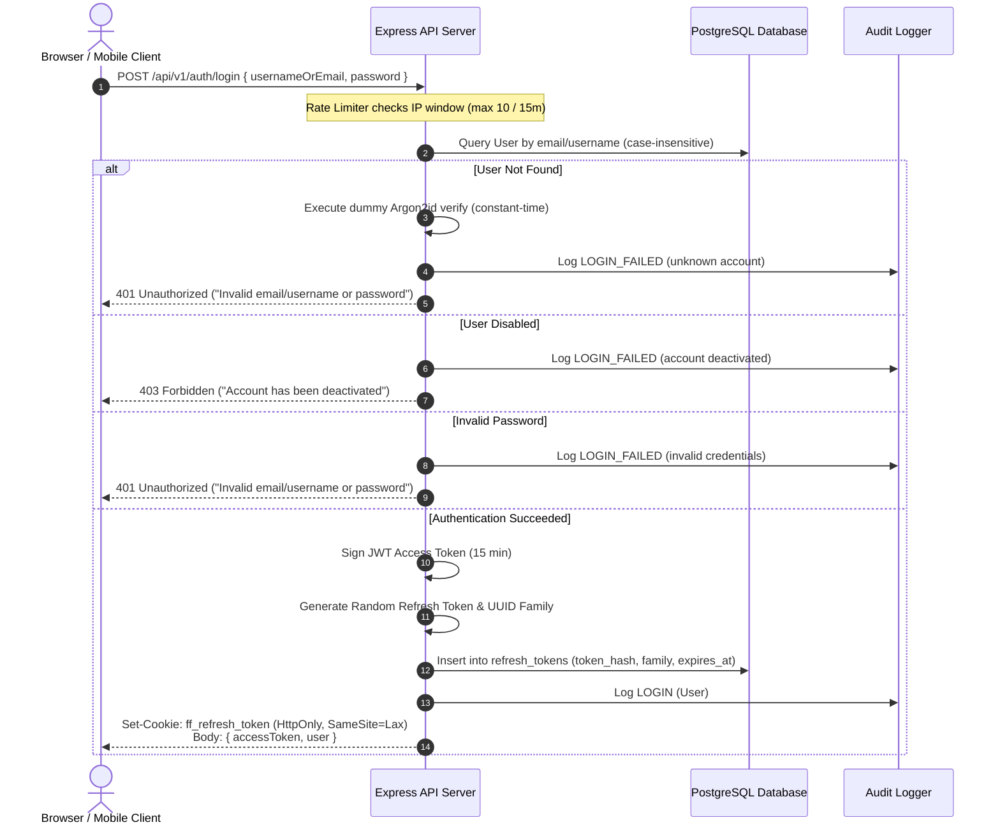

# FoodFactory ERP – Authentication Architecture

## 1. Overview & Security Objectives

FoodFactory ERP provides a production-grade, multi-tiered authentication architecture designed for a small-to-medium South Indian packaged food manufacturer operating across desktop, tablet, and mobile browsers.

The authentication engine guarantees:

1. **Confidentiality:** Plaintext passwords and raw refresh tokens are never persisted in the database or exposed in server logs.
2. **Account Enumeration Protection:** Generic failure messages and constant-time dummy password hashing eliminate account enumeration and timing side-channel attacks.
3. **Session Integrity:** Cryptographically signed, short-lived JSON Web Tokens (JWT) paired with stateful, rotating refresh tokens stored in HTTP-only, SameSite cookies.
4. **Token Reuse Detection:** Token families detect replay attacks and automatically revoke the entire compromised session lineage.
5. **Least Privilege & Role-Based Access Control:** Granular server-side permissions verified at every protected endpoint.

---

## 2. Cryptographic Standards & Parameterization

### 2.1 Password Hashing: Argon2id

Password storage uses **Argon2id** (RFC 9106), the winner of the Password Hashing Competition (PHC), providing hybrid resistance against GPU/ASIC attacks and side-channel cache attacks.

```typescript
argon2.hash(password, {
  type: argon2.argon2id,
  memoryCost: 65536, // 64 MiB
  timeCost: 3, // 3 iterations
  parallelism: 1, // 1 lane
});
```

### 2.2 Password Policy Specification

- Minimum length: 8 characters; Maximum length: 128 characters.
- Complexity: At least one uppercase letter `[A-Z]`, one lowercase letter `[a-z]`, one digit `[0-9]`, and one special character `[!@#$%^&*()_+\-=[\]{};':"\\|,.<>/?]`.

### 2.3 Access Token: Stateless JWT

- **Algorithm:** HMAC-SHA256 (`HS256`)
- **Lifespan:** 15 minutes (`JWT_ACCESS_EXPIRY=15m`)
- **Payload Claims:**
  - `userId`: Subject UUID
  - `username`: Unique username string
  - `email`: Normalized login email address
  - `roles`: String array of assigned ERP role codes (e.g., `["SALESMAN"]`)
  - `permissions`: Deduplicated array of granular permission codes (e.g., `["sales.orders.create", "inventory.read"]`)
  - `iss`: `foodfactory-erp`
  - `aud`: `foodfactory-app`
  - `exp`: Unix timestamp (15 minutes from issuance)

### 2.4 Refresh Token: High-Entropy Rotating Secret

- **Generation:** 48 bytes of cryptographically secure random entropy (`crypto.randomBytes(48).toString('base64url')`).
- **Database Persistence:** Persisted **only** as an HMAC-SHA256 hash using a server pepper (`JWT_REFRESH_SECRET`). Raw refresh tokens are never stored.

---

## 3. Authentication & Session Lifecycles

### 3.1 Login Flow



### 3.2 Silent Refresh & Rotation Flow

```mermaid
sequenceDiagram
    autonumber
    actor Client as Web Application (apiClient)
    participant API as Express API Server
    participant DB as PostgreSQL Database
    participant Audit as Audit Logger

    Client->>API: GET /api/v1/protected-resource (Authorization: Bearer <expired-jwt>)
    API-->>Client: 401 Unauthorized (code: TOKEN_EXPIRED)
    Note over Client: Interceptor halts requests & triggers refreshAccessToken()
    Client->>API: POST /api/v1/auth/refresh (Cookie: ff_refresh_token)
    API->>API: HMAC-SHA256 Hash incoming raw refresh token
    API->>DB: Query refresh_tokens by token_hash
    alt Token Hash Not Found OR Expired
        API-->>Client: 401 Unauthorized ("Invalid or expired refresh token")
    else Token Record Has is_revoked = true (REUSE DETECTED!)
        API->>DB: UPDATE refresh_tokens SET is_revoked = true WHERE family = :family
        API->>Audit: Log SECURITY_ALERT ("Token reuse detected; revoked family")
        API-->>Client: 401 Unauthorized ("Token reuse detected")
    else Valid Active Token
        API->>DB: UPDATE refresh_tokens SET is_revoked = true WHERE id = :id
        API->>API: Generate new Refresh Token (same family)
        API->>DB: INSERT into refresh_tokens (new_hash, family, expires_at)
        API->>API: Sign fresh JWT Access Token (15 min)
        API-->>Client: Set-Cookie: ff_refresh_token (new token)<br/>Body: { accessToken, user }
        Note over Client: Replay original request with fresh Access Token
        Client->>API: GET /api/v1/protected-resource (Authorization: Bearer <fresh-jwt>)
        API-->>Client: 200 OK (data payload)
    end
```

---

## 4. Client-Side Token Storage Strategy

| Token Type        | Storage Location                      | Lifetime   | Security Rationale                                                                                                                           |
| :---------------- | :------------------------------------ | :--------- | :------------------------------------------------------------------------------------------------------------------------------------------- |
| **Access Token**  | JavaScript In-Memory Variable         | 15 Minutes | Inaccessible to cross-site scripting (XSS) scripts accessing `localStorage` or `sessionStorage`. Cleared on page refresh/tab close.          |
| **Refresh Token** | HTTP-Only Cookie (`ff_refresh_token`) | 7 Days     | Inaccessible to document JavaScript (`document.cookie`). Protected by `SameSite=Lax` and `Secure` flags. Transmitted only to `/api/v1/auth`. |

---

## 5. Defense-in-Depth Protections

1. **Anti-Enumeration Latency Equalization:** When an invalid username is submitted, the server hashes the password against an in-memory `dummyHash` to match the CPU work of a real user lookup, preventing timing attacks.
2. **Brute-Force Rate Limiting:** Login routes are throttled to 10 attempts per 15 minutes per IP address using `express-rate-limit`. Refresh routes are capped at 30 requests per 15 minutes.
3. **Audit Log Trail:** Every authentication attempt, password failure, session invalidation, and permission denial generates an immutable row in `audit_logs`.
